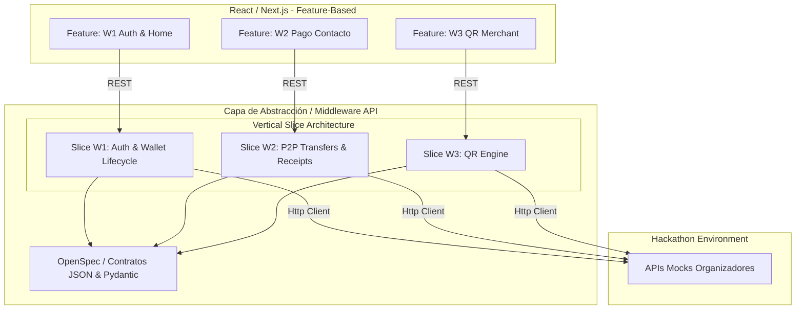

# CrewAI para equipos

Los agentes parten con instrucciones básicas. Sigue [Mejora tu agente](MEJORA_TU_AGENTE.md) para completar el ejercicio y consultar resultados desde el portal.

Base de trabajo del Lab 4, S1. Lee una funcionalidad del backlog mediante MCP Projects
y genera una solución Quarkus 3.x y Angular 17 con seis agentes de CrewAI, o siete cuando el equipo activa Datos y persistencia.
Cada agente tiene su definición y la tarea en un archivo propio.

## Editar tu agente

Los agentes son básicos: un objetivo breve, una responsabilidad por rol y una salida concreta.
Usa un requisito pequeño, por ejemplo crear una tarea con título.
Ajusta ese ejemplo al requisito del backlog de tu equipo.
Testing propone un caso válido y otro inválido; Security revisa entradas y secretos;
Chapter compara las entregas con el requisito. Los prompts conservan los formatos
que necesita el flujo para guardar código y revisar resultados.

Cada participante edita el archivo de su rol:

- `agents/architect.py`
- `agents/backend.py`
- `agents/frontend.py`
- `agents/testing.py`
- `agents/security.py`
- `agents/chapter.py`

El orden es `architect → backend → frontend → testing → security → chapter`.
Chapter reemplaza al LT como revisor final. La aprobación humana se conserva entre etapas.
Consulta [TEAM.md](TEAM.md) para crear el repo de tu equipo y repartir los archivos.

## Preparar el entorno

Requiere Python 3.11 a 3.13, Git y acceso a GitHub Copilot.
Usa Python 3.12 durante el taller y ejecuta los comandos en Bash. En Windows, abre Git Bash.

```bash
python -m venv .venv
if [ -f .venv/Scripts/activate ]; then
  source .venv/Scripts/activate
else
  source .venv/bin/activate
fi
python -m pip install -r requirements.txt
[ -f .env ] || cp .env.example .env
```

Si en macOS o Linux tu instalación se llama `python3.12`, úsala para crear el entorno. Una vez activado, ejecuta `python`.

Instala [Copilot CLI](https://github.com/features/copilot/cli), abre `copilot` y ejecuta `/login`.
El SDK usa esa sesión con `COPILOT_USE_LOGGED_IN_USER=true`.
El modelo predeterminado es `gpt-6-luna` con esfuerzo `high`. Cada llamada consume uso del plan de Copilot.
Puedes descargar su runtime antes del taller con `python -m copilot download-runtime`.

## Conectar el backlog

Configura `.env` con el owner y repo del producto de tu equipo, `PROJECTS_MCP_URL`
y `PROJECTS_MCP_API_KEY`. Estos valores apuntan al servicio MCP del taller.
El repo del producto contiene el backlog; este repo contiene el código del Crew.

Si usas el MCP local del Lab 4, levántalo en otra terminal desde
`support/mcp-local` con el script `start-mcp.sh`.
Ese servicio requiere la imagen `localhost/mcp-github-project-manager:latest`, preparada por el instructor, y Podman o Docker. Si no tienes esa imagen, solicita al instructor un endpoint MCP del taller.
En macOS o Linux:

```sh
cd support/mcp-local
gh auth refresh -s project
bash start-mcp.sh --owner TU_OWNER --repo TU_PRODUCTO
```

Mantén esa terminal Bash abierta y ejecuta `python main.py` en otra terminal desde la raíz del repo. La URL de S1 es `http://localhost:8081`.

## Ejecutar el Crew

Desde la raíz de este repo, con el entorno virtual activado:

```sh
python main.py
```

Selecciona el proyecto y la funcionalidad. Cada paso ejecuta un mini-Crew de un agente.
En la aprobación humana puedes usar `s` para aprobar, `r` para reintentar con feedback,
o `n` para rechazar y detener el flujo. El checkpoint permite retomar los pasos aprobados.

#### Flujo general

```mermaid
flowchart TD
    A([python main.py]) --> B[MCP Proyectos :8081<br/>tools/list + autenticación]
    B --> C[list_projects: elegir proyecto]
    C --> D[list_project_items: elegir feature del backlog]
    D --> E[get_feature_from_item<br/>título, descripción, criterios de aceptación]
    E --> F{¿Checkpoint en<br/>output/.checkpoint.json?}
    F -- otro feature --> F1{¿Empezar de cero?}
    F1 -- no --> X([Fin])
    F1 -- sí --> G
    F -- mismo feature o ninguno --> G[Cargar pasos aprobados<br/>+ ensure_scaffolding]
    G --> H[Enriquecer Arquitecto con<br/>HEX_PROMPT_PREFIX + brief del feature]
    H --> S1

    subgraph LOOP [Un mini-Crew por agente, en secuencia]
        direction TB
        S1[1. Arquitecto] --> S1D{{Datos y persistencia<br/>solo si CREWAI_INCLUDE_DATA=true}}
        S1D --> S2[2. Backend Quarkus]
        S2 --> S3[3. Frontend Angular]
        S3 --> S4[4. Pruebas]
        S4 --> S5[5. Seguridad]
        S5 --> S6[6. Chapter<br/>revisor final]
    end

    S6 --> V[Veredicto del Chapter]
    V --> Q{¿PUBLISH_ENABLED<br/>y hay archivos?}
    Q -- no --> Z([Fin])
    Q -- sí --> R{¿Crear rama y PR? s/n}
    R -- n --> Z
    R -- s --> W[Agente Publicador<br/>redacta título y cuerpo del PR]
    W --> W1{¿Chapter APROBADO?}
    W1 -- sí --> Y[draft = false]
    W1 -- no --> Y2[draft = true]
    Y --> G1
    Y2 --> G1
    G1[git clone temporal de<br/>GITHUB_OWNER/GITHUB_REPO] --> G2[checkout -b crewai/feature-fecha<br/>copiar output/ a source/<br/>commit + push]
    G2 --> M[MCP local :8081<br/>manage_prs action=create<br/>head=rama nueva, base=main]
    M --> PR([PR abierto en ai-labs])
```




El detalle de cada paso (revisión humana y checkpoint) y el diagrama de secuencia entre componentes están en [docs/FLUJO.md](docs/FLUJO.md).

Los artefactos se guardan en `output/`:

- `specs/user_story.md`: especificación del arquitecto.
- `specs/backend_spec.md` y `specs/frontend_spec.md`: implementaciones.
- `specs/testing_report.md`: casos, tests y comandos. Los resultados quedan pendientes de ejecución humana.
- `specs/security_report.md`: hallazgos y verificaciones de seguridad.
- `specs/chapter_review.md`: revisión final del Chapter.
- `backend-quarkus/` y `frontend-angular/`: código extraído y configuración de arranque.
- `db/<slice>/`: SQL propuesto por Datos, aislado por slice.
- `.checkpoint.json`: estado local de la ejecución (no se publica).

## Estrategia de arquitectura (hackathon)



Fuente del diagrama: [archivo-apoyo/estrategia.mmd](archivo-apoyo/estrategia.mmd).

## Backend: Vertical Slice Architecture

Cada funcionalidad es un slice autocontenido, de modo que dos funcionalidades no editan los mismos archivos:

```text
backend-quarkus/src/main/java/pe/bcp/
  <slice>/    recurso REST, servicio, acceso a datos, DTOs y excepciones (paquete plano)
  shared/     solo piezas transversales y estables (errores HTTP, correlación, auditoría)
backend-quarkus/src/test/java/pe/bcp/<slice>/
db/<slice>/
```

- Un slice nunca importa a otro slice, y `shared` nunca importa a un slice.
- El nombre del slice sale del título de la feature (por ejemplo, «Transfer funds» → `transferfunds`). Puedes fijarlo con `CREWAI_SLICE` y queda guardado en el checkpoint.
- `main.py` inyecta las reglas a Arquitecto, Datos, Backend, Pruebas y Chapter. Al extraer el código, `vsa_archetype.py` ubica cada archivo Java en el paquete del slice y aplana subpaquetes por capa.
- Al final se ejecuta `vsa_archetype.validate()` y se imprime si los slices son planos y aislados.

## Frontend: feature slice e independencia backend/frontend

El frontend sigue el mismo criterio que el backend y comparte con él solo el nombre del slice (derivado del issue) y el contrato de API del Arquitecto:

```text
frontend-angular/src/app/<slice>/   componentes, servicio HTTP, modelos, estilos y <slice>.routes.ts (carpeta plana)
frontend-angular/src/app/app.routes.ts, app.component.ts, src/main.ts   los genera el andamiaje (una ruta lazy por slice)
```

- Backend y Frontend solo reciben el issue y la salida del Arquitecto (`CONTEXT_SOURCES` en `crew/workflow.py`); ninguno ve la salida del otro. Pruebas, Seguridad y Chapter sí ven todo.
- `extract_and_save_code()` limita lo que cada paso puede escribir (`STEP_ARTIFACTS`): Backend solo Java/SQL/config, Frontend solo `.ts/.html/.css`. Los archivos del andamiaje que emita el modelo se descartan.
- `frontend_archetype.py` inyecta las reglas del slice, ubica los archivos en `src/app/<slice>/`, regenera `app.routes.ts` y valida al final que ningún slice importe a otro.
- Ningún prompt fija el dominio: la funcionalidad sale solo del issue de GitHub elegido.

## Publicar la fuente en el repo remoto

Al aprobarse todos los pasos, `main.py` ofrece publicar `output/`:

1. Pide confirmación `[s/n]`.
2. El agente Publicador (`agents/publisher.py`) redacta título y cuerpo del PR con el veredicto del Chapter.
3. Con `git` crea una rama `crewai/<feature>-<fecha>` en un clon temporal de `GITHUB_OWNER/GITHUB_REPO` (el mismo repo que resuelve tu MCP local), copia los archivos de texto a `source/` y la sube. El MCP local no puede escribir archivos, por eso este paso usa `git` con tus credenciales.
4. Abre el PR con la tool `manage_prs` del MCP local (`publish.py`). Si el Chapter no aprobó, el PR queda en borrador.

Configuración en `.env` (ver `.env.example`): `GITHUB_OWNER`, `GITHUB_REPO`, `PUBLISH_BASE_BRANCH` (`main`) y `PUBLISH_TARGET_DIR` (`source`). Usa `PUBLISH_ENABLED=false` para omitirlo.

## Probar la solución generada

Con Java 17 o superior y Maven instalados, abre una terminal en `output/backend-quarkus`:

```sh
mvn test
mvn compile quarkus:dev
```

Con Node.js 18.19 o superior y npm, abre otra terminal en `output/frontend-angular`:

```sh
npm install
npm start
```

La API se inicia en `http://localhost:8080` y Angular en `http://localhost:4200`.
Revisa los comandos adicionales del informe de pruebas y registra sus resultados reales.

## Verificar cambios en los agentes

```sh
python tools/verify.py
```

Los checks recorren los seis roles, verifican artefactos, contexto y reanudación.
Sustituyen las llamadas al modelo y a MCP para ejecutarse sin credenciales.
La ejecución real de Copilot y MCP requiere el entorno del taller.

Consulta [SOURCE.md](SOURCE.md) para ver el origen de esta copia.

## Equipo de siete (solo CrewAI)

El grupo de siete añade un responsable de **Datos y persistencia**, que edita
únicamente `agents/data.py` y entrega su propio PR. Los equipos de seis mantienen
sus seis roles. En `team.json`, solo el equipo de siete añade `"data": "usuario-real"`
dentro de `roles`, con un usuario distinto de los otros responsables.

Antes de iniciar un flujo nuevo, el líder del equipo de siete configura
`CREWAI_INCLUDE_DATA=true` en su `.env`. El orden será Arquitectura → Datos y
persistencia → Backend → Frontend → Pruebas → Seguridad → Chapter. Cada etapa
mantiene aprobación, rechazo y reintento humanos. Datos produce `output/specs/data_spec.md`
y propuestas SQL en `output/db/`; no ejecuta migraciones. Backend usa ese contrato
y Chapter lo revisa. Los participantes mejoran las instrucciones iniciales de su agente.

Por defecto la variable es `false`. Un checkpoint de seis etapas no se reutiliza
en el flujo de siete ni viceversa: conserva la carpeta `output/` con otro nombre
antes de cambiar el modo. No borres evidencia previa para cambiar de flujo.
