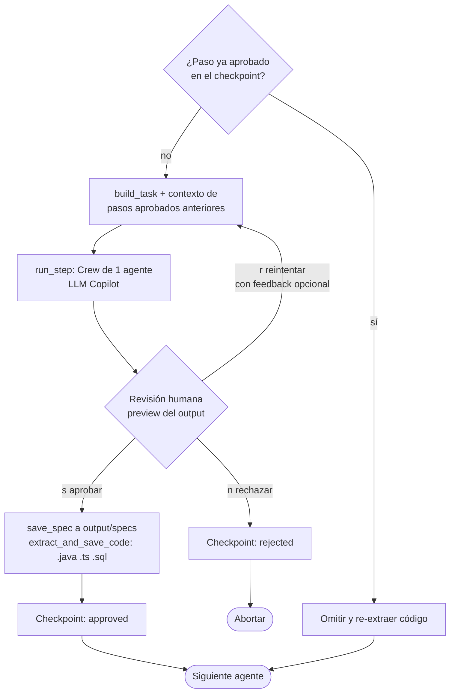
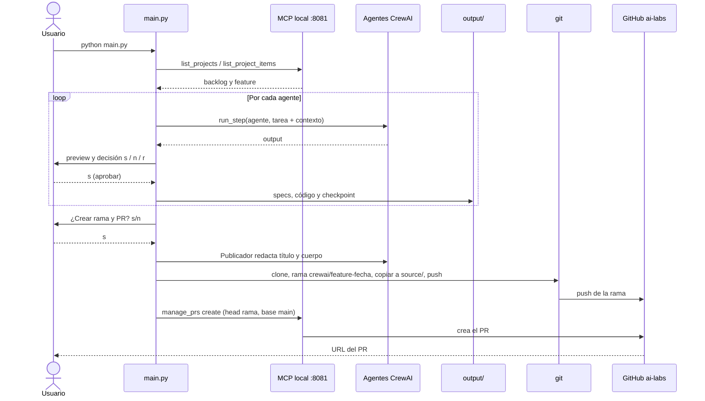

# Flujo de orquestación de agentes

Recorrido completo de `python main.py`: backlog por MCP → agentes con aprobación humana → publicación de la fuente en un PR.

## 1. Flujo general

```mermaid
flowchart TD
    A([python main.py]) --> B[MCP Proyectos :8081<br/>tools/list + autenticación]
    B --> C[list_projects: elegir proyecto]
    C --> D[list_project_items: elegir feature del backlog]
    D --> E[get_feature_from_item<br/>título, descripción, criterios de aceptación]
    E --> F{¿Checkpoint en<br/>output/.checkpoint.json?}
    F -- otro feature --> F1{¿Empezar de cero?}
    F1 -- no --> X([Fin])
    F1 -- sí --> G
    F -- mismo feature o ninguno --> G[Cargar pasos aprobados<br/>+ ensure_scaffolding]
    G --> H[Enriquecer Arquitecto con<br/>HEX_PROMPT_PREFIX + brief del feature]
    H --> S1

    subgraph LOOP [Un mini-Crew por agente, en secuencia]
        direction TB
        S1[1. Arquitecto] --> S1D{{Datos y persistencia<br/>solo si CREWAI_INCLUDE_DATA=true}}
        S1D --> S2[2. Backend Quarkus]
        S2 --> S3[3. Frontend Angular]
        S3 --> S4[4. Pruebas]
        S4 --> S5[5. Seguridad]
        S5 --> S6[6. Chapter<br/>revisor final]
    end

    S6 --> V[Veredicto del Chapter]
    V --> Q{¿PUBLISH_ENABLED<br/>y hay archivos?}
    Q -- no --> Z([Fin])
    Q -- sí --> R{¿Crear rama y PR? s/n}
    R -- n --> Z
    R -- s --> W[Agente Publicador<br/>redacta título y cuerpo del PR]
    W --> W1{¿Chapter APROBADO?}
    W1 -- sí --> Y[draft = false]
    W1 -- no --> Y2[draft = true]
    Y --> G1
    Y2 --> G1
    G1[git clone temporal de<br/>GITHUB_OWNER/GITHUB_REPO] --> G2[checkout -b crewai/feature-fecha<br/>copiar output/ a source/<br/>commit + push]
    G2 --> M[MCP local :8081<br/>manage_prs action=create<br/>head=rama nueva, base=main]
    M --> PR([PR abierto en ai-labs])
```

## 2. Detalle de cada paso de agente (HITL + checkpoint)

## 3. Secuencia entre componentes

## Referencias

| Pieza | Archivo |
|---|---|
| Orquestación y HITL | [main.py](../main.py) |
| Orden de agentes | [crew/workflow.py](../crew/workflow.py) |
| Cliente MCP de proyectos | [mcp_projects.py](../mcp_projects.py) |
| Agente Publicador | [agents/publisher.py](../agents/publisher.py) |
| Rama, push y PR | [publish.py](../publish.py) |
